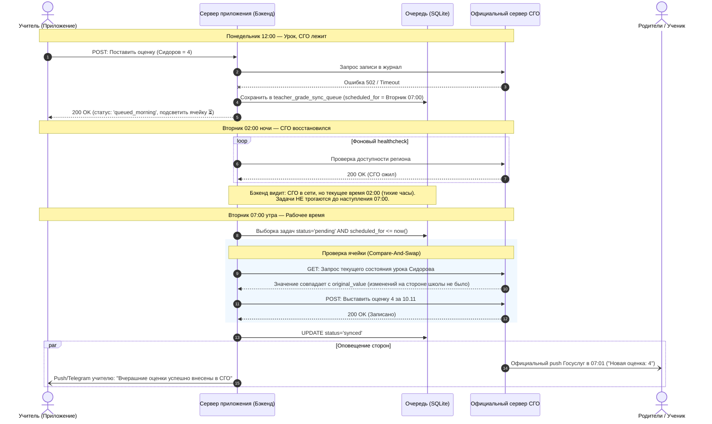
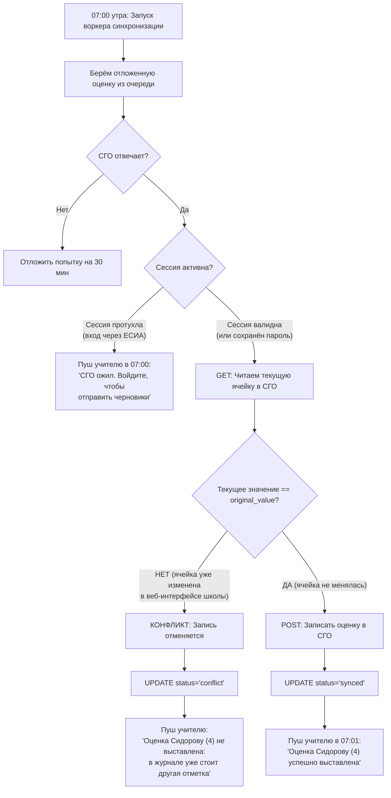

# Спецификация отложенной синхронизации учительского журнала

Документ описывает архитектуру, алгоритмы и требования безопасности для функционала
офлайн-редактирования оценок в учительском журнале и их последующей синхронизации с «Сетевым городом».

---

## 1. Контекст и проблематика

* **Проблема:** Во время уроков серверы региональных систем «Сетевого города» (СГО)
  или школьный интернет часто становятся временно недоступны (сбои, перегрузка, техработы).
* **Цель:** Позволить учителю бесперебойно вести урок и выставлять/изменять оценки в приложении
  в офлайн-режиме (черновики), гарантируя при этом безопасную доставку данных в СГО при восстановлении связи
  без конфликтов, ночных сбоев и юридических рисков.

---

## 2. Юридическая и техническая безопасность

1. **ст. 272 УК РФ (Неправомерный доступ и модификация информации ГИС):**
   * Любые действия по изменению классного журнала в государственной информационной системе
     должны быть легитимны.
   * **Запрещены тайные ночные отправки:** Сервер СГО пишет подробные логи аудита (время, IP, действие).
     Пакетное выставление оценок в 02:00–04:00 ночи с IP дата-центра расценивается службами безопасности
     школы как несанкционированный взлом аккаунта учителя.
   * **Явное согласие (Opt-in):** Автоматическая отправка черновиков включается учителем явным
     тумблером в настройках (по умолчанию выключена). Включение тумблера является прямым волеизъявлением
     педагога на выполнение отложенной синхронизации.
2. **Соблюдение регламентов школы и комфорт родителей:**
   * При выставлении оценок в СГО государственные сервисы (включая Госуслуги) отправляют пуш-уведомления
     родителям учеников.
   * Синхронизация строго блокируется в «тихие часы» (с 20:00 до 07:00) и планируется на начало
     рабочего дня (07:00 утра), чтобы не тревожить родителей ночью.
3. **152-ФЗ:**
   * Данные очереди черновиков хранятся на российском сервере и привязаны к учётной записи учителя.
   * При удалении аккаунта учителя или отзыве сессии очередь черновиков гарантированно очищается.

---

## 3. Пользовательский интерфейс (UX)

### А. На уроке при сбое связи
1. При попытке выставить оценку сервер фиксирует недоступность СГО (таймаут, 502/503).
2. Оценка сохраняется в локальную очередь черновиков.
3. В интерфейсе журнала ячейка получает визуальный статус черновика:
   * Тёплая пунктирная рамка (или бейдж с часиками `⏳ 4`).
   * В шапке появляется статус: `⚠️ СГО не отвечает · 3 оценки в черновике`.
4. Учитель может продолжать редактировать оценку (например, сменить 4 на 5 или удалить) —
   черновик обновляется на месте.

### Б. Управление синхронизацией в настройках
В настройках профиля учителя доступен раздел:
> **Отложенная синхронизация оценок**
> * `[✓] Автоматически отправлять черновики при появлении связи (утром с 07:00 до 19:00)`
> * Кнопка «Синхронизировать сейчас» (для принудительной отправки вручную).

---

## 4. Схема данных (SQLite)

Таблица очереди в базе данных бота:

```sql
CREATE TABLE IF NOT EXISTS teacher_grade_sync_queue (
    id                  INTEGER PRIMARY KEY AUTOINCREMENT,
    owner_id            INTEGER NOT NULL,              -- telegram_id / account_id учителя
    school_url          TEXT    NOT NULL,
    class_id            INTEGER NOT NULL,
    subject_group_id    INTEGER NOT NULL,
    term_id             INTEGER NOT NULL,
    year_id             INTEGER NOT NULL,
    student_id          INTEGER NOT NULL,
    lesson_id           INTEGER NOT NULL,              -- конкретный урок/колонка
    date                TEXT    NOT NULL,              -- YYYY-MM-DD урока
    grade_value         TEXT    NOT NULL,              -- '5', '4', '3', '2', 'Н' (или пустая строка при удалении)
    original_value      TEXT    NOT NULL DEFAULT '',   -- значение ячейки ДО редактирования (для CAS)
    created_at          INTEGER NOT NULL,              -- unix timestamp
    scheduled_for       INTEGER NOT NULL,              -- unix timestamp, не ранее 07:00 следующего дня, если сбой был вечером
    status              TEXT    NOT NULL DEFAULT 'pending', -- 'pending', 'synced', 'conflict', 'expired', 'cancelled'
    conflict_reason     TEXT    NOT NULL DEFAULT '',
    updated_at          INTEGER NOT NULL
);

CREATE INDEX IF NOT EXISTS idx_teacher_sync_pending
ON teacher_grade_sync_queue (status, scheduled_for);
```

---

## 5. Временная шкала сценария (Sequence Diagram)

Сценарий: сбой в понедельник в 12:00 $\to$ восстановление СГО во вторник в 02:00 ночи $\to$ синхронизация в 07:00 утра.



---

## 6. Алгоритм и обработка конфликтов (Flowchart)

Перед отправкой каждой оценки выполняется оптимистичная проверка состояния ячейки:



---

## 7. Граничные случаи (Edge Cases)

1. **Вход через Госуслуги (ЕСИА):**
   * Пароли Госуслуг не сохраняются на сервере (только временный session-token).
   * Если за ночь сессия ЕСИА истекла, сервер **не имеет права и возможности войти самостоятельно**.
   * *Действие:* в 07:00 утра учителю направляется уведомление с кнопкой быстрого входа. После прохождения авторизации очередь сразу отправляется.
2. **Время жизни черновика (TTL):**
   * Если СГО лежит непрерывно более 36 часов, автоматическая синхронизация отменяется со статусом `expired`.
   * Учителю направляется запрос на ручную сверку: автоматическая отправка данных двухдневной давности недопустима.
3. **Отмена учителем до 07:00:**
   * Если учитель вечером передумал, он может открыть журнал в приложении и нажать «Очистить неотправленные черновики».
